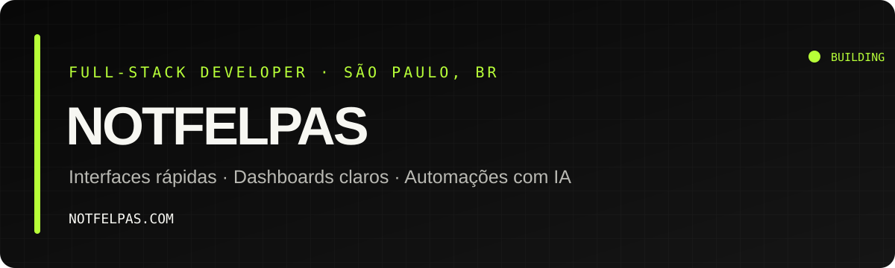
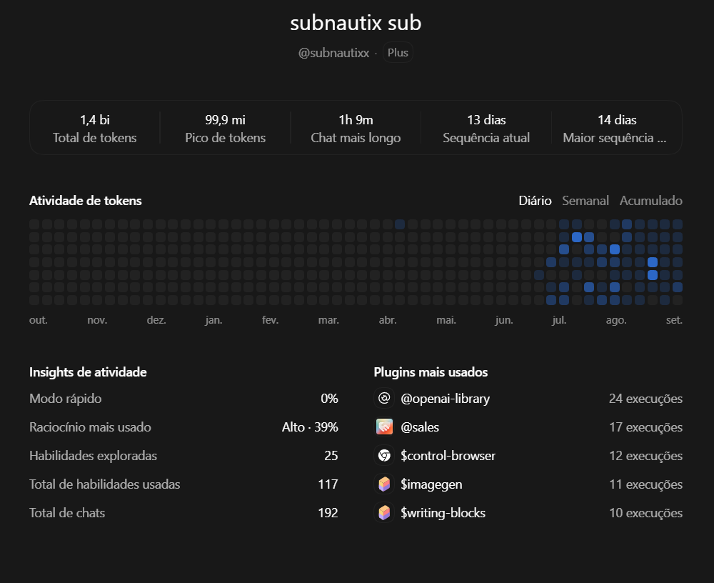
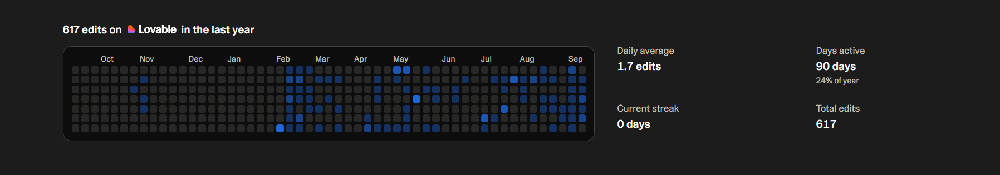

<div align="center">
  

  <p><a href="https://notfelpas.com/">Portfólio e contato →</a></p>
</div>

## Olá, eu sou notfelpas.

Desenvolvedor full-stack em São Paulo, construindo produtos digitais desde 2022. Meu foco é transformar problemas de negócio em interfaces rápidas, dashboards claros e automações com IA que funcionam no mundo real.

- Produtos web do protótipo ao deploy
- Integrações com APIs, WhatsApp e dados em tempo real
- Código documentado, escopo claro e entrega sem caixa-preta

## Projetos em destaque

| Projeto | O que resolve | Stack |
| --- | --- | --- |
| **[ShowOnce](https://github.com/subnautixx/showonce)** | Projeto principal. Você faz uma tarefa uma vez no navegador e recebe um workflow do n8n que a repete: a IA entende a intenção e usa nós de API, sem imitar cliques. | Chrome Extension · Node.js · n8n · MCP · Claude |
| [4F Motors CRM](https://github.com/subnautixx/4f-motors-crm) | Operação de prospecção e atendimento via WhatsApp, com segurança por RLS e acompanhamento em tempo real. | Next.js · TypeScript · Supabase · Meta API |
| [4F Motors AI Sales](https://github.com/subnautixx/4f-motors-ai-sales) | Qualifica leads, consulta estoque e transfere oportunidades quentes para um vendedor humano. | Node.js · TypeScript · Claude · Evolution API |
| [notfelpas.com](https://notfelpas.com/) | Meu portfólio e ponto de contato para novos projetos. | React · UI Engineering · SEO |

## Ferramentas que uso

<p>
  
  
  
  
  
  
</p>

Também trabalho com TanStack, Vite, PostgreSQL, Meta API, WhatsApp Cloud, Evolution API e integrações com modelos de IA.

## Era só um projetinho. 1,4 bilhão de tokens depois…

Eu gosto de vibe codar. Muito. Tenho uma ideia, abro o chat e penso: “isso aqui dá pra fazer rapidinho”. Aí vem outra ideia, mais um ajuste, um “e se…”. Quando percebo, o projetinho já tem dashboard e eu tô escolhendo a animação do botão.

Se precisasse de comprovante, tá aqui.

### 1,4 bilhão de tokens
*Aparentemente, eu tinha bastante coisa pra perguntar.*



### 617 edições no Lovable
*A última alteração. Pela 617ª vez.*

<a href="./assets/lovable-activity.png">
  
</a>

<sub>Registro de setembro de 2026. Os números continuam subindo; os prints, por enquanto, não.</sub>

## Como eu construo

```text
problema real  →  escopo claro  →  produto funcional  →  evolução com dados
```

Gosto de interfaces com personalidade, sistemas simples de operar e decisões técnicas que continuam fazendo sentido depois do lançamento.

<div align="center">
  <strong>Tem um produto, dashboard ou automação para tirar do papel?</strong><br />
  <a href="https://notfelpas.com/#contato">Vamos conversar →</a>
</div>

